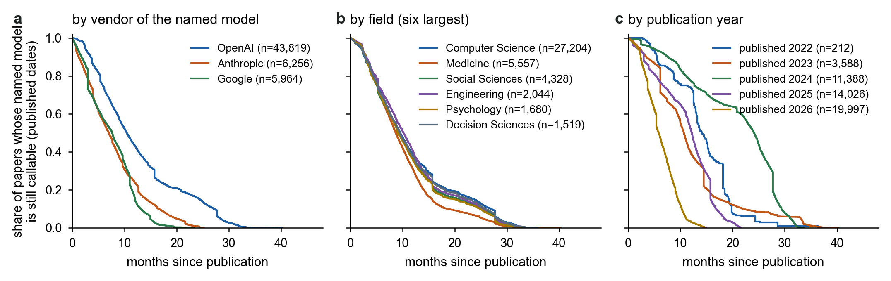

<h1 align="center">HALF-LIFE</h1>

<p align="center"><b>The half-life of science that depends on commercial language models</b></p>

<p align="center">
  <!-- swap for Zenodo's own badge (https://zenodo.org/badge/DOI/10.5281/zenodo.22995877.svg) once the record is published; it returns 403 while the record is restricted -->
  <a href="https://doi.org/10.5281/zenodo.22995877"></a>
  <a href="https://github.com/Erzyh/HALF-LIFE/actions/workflows/reproduce.yml"></a>
  <a href="LICENSE"></a>
  <a href="LICENSE-data"></a>
  <a href="requirements.txt"></a>
  <a href="CITATION.cff"></a>
</p>
<!-- at publication, add a paper badge (journal, DOI) as the first item of the row above -->

This repository holds the census, the re-execution harness and configurations, the analysis scripts and the data
tables behind the paper. It was built from the working repository at commit `00328e4` (2026-10-12); the
request-response archives of every API call (3,307 files, 3.2 GB uncompressed) are in the Zenodo record, not here.

## Summary

Tens of thousands of papers a year report results produced by commercial language-model services. The vendors withdraw
those models on their own schedules, and shared code and data cannot restore a result once the model that produced it is
gone. We measure how long such results stay executable and what becomes of them afterwards. In a census of 58,620 papers
that name a model identifier with a published retirement date, the first named model is withdrawn a median of nine
months after publication on the vendors' schedules; a third of the papers had already lost it by October 2026, nineteen
in twenty will have by the end of the year, and one paper in six named a model that was already gone when the paper
appeared. Before the current
retirement deadlines we re-executed 107 papers on the still-callable models. No repository-based re-execution died, and
two-thirds of the prompt-level re-executions reproduced the reported number. We then moved the same configurations to
four kinds of successor: the replacement designated by the vendor, a non-reasoning successor, an open-weight model and
another vendor's closed model. Between half and two-thirds of the scorable results moved by more than five points. A
successor re-measures a result; it does not preserve it. Call-to-call noise, serving precision and the wording of the
instruction text move results far less than the replacement does, and repository-based papers move the same way. From
thirteen observed modes of loss we derive a preservation protocol and apply it to this study.



## What is where

| Path | Content |
|---|---|
| `halflife/target_models.json` | The 117 identifiers with a published retirement date (55 fixed on 2 September 2026, 20 added on 2 October, 6 on 11 October and 36 on 12 October under the completeness rule recorded in the file) with release and retirement dates and the vendor pages they were read from (`halflife/data/vendor_pages/`). |
| `halflife/data/` | Census (`census_v2.csv`), survival and sensitivity tables, Cox models, re-execution summaries, successor-condition summaries, loss typology, effort accounting, coding results, deposit manifest. Every table in the paper and the supplement is a file here. |
| `halflife/scripts/` | Harvest, aggregation, survival analysis, summaries, figures and supplementary tables. Scripts that need an API key are listed below; all others run from the committed data. |
| `halflife/harness/` | The re-execution harness: `tierb_runner.py` (prompt-level papers), `run_queue.py` (spending-capped queue), `openai_client.py` (OpenAI-compatible client for the four providers), per-paper configurations (`tierb/configs/`), hooks (`tierb/hooks/`), triage records (`tierb/W*.json`), claim cards for repository-based papers (`cards/`) and adapters (`adapters/`). |
| `halflife/runs/` | Per-run summaries: `result.json`, `prepare.json`, `budget.json`, `run_meta.json` for the pre-retirement runs (`runs/W*` repository-based, `runs/tierb/W*` prompt-level) the successor conditions and the robustness checks (`runs/tierb_p3/<condition>/W*`: `vendor`, `gpt41`, `open70b`, `gemini_flash`, `drift_ctrl`, `<condition>_rep`, `open70b_bf16`, `para_p1`, `para_p2`) and the repository-based papers re-run on the designated replacement (`runs/W*/successor_vendor/`). The full request and response logs are in the Zenodo deposit. |
| `halflife/figures/` | The figures of the paper and the supplement, as produced by the scripts. |
| `halflife/coding/` | Codebook for the manual coding of the census sample, the workbooks distributed to the coders (anonymised A to D), the returned pilot and main-sample sheets with the third-coder adjudication and the merge outputs, and the three-judge judgement of the re-execution results (blinded sheets, returns, condition key and the record of query rounds). |
| `halflife/SUPPLEMENTARY_TABLES.md` | Supplementary Tables 1 to 49, regenerated by `scripts/supp_tables.py`. |
| `halflife/ANALYSIS_PLAN.md`, `halflife/ANALYSIS_DEVIATIONS.md`, `halflife/SUPPLEMENTARY.md`, `halflife/coding/CODEBOOK.md` | The analysis plan fixed before the runs, the log of deviations from it, the supplementary notes and the codebook. These working documents are in Korean and are kept as written. |
| `MANIFEST.csv` | Path, size and SHA-256 of every file in this release. |

## Reproducing the tables and figures

Everything below runs from the committed data without an API key.

```bash
python -m venv .venv && . .venv/bin/activate      # Windows: .venv\Scripts\activate
pip install -r requirements.txt
cd halflife
python scripts/census_survival.py      # Fig. 2, Table 1 inputs, data/census_survival_summary.csv
python scripts/sensitivity.py          # Supplementary Tables 5-6, figures/sensitivity.png
python scripts/cox_model.py            # Table S7, figures/cox_forest.png
python scripts/cox_checks.py           # Tables S21-S23, figures/cox_ph_check.png
python scripts/lifecycle_figure.py     # Fig. 1b, data/model_lifecycles.csv
python scripts/reexec_forest.py        # Fig. 3, data/reexec_forest.csv
python scripts/drift_figure.py         # Fig. 4
python scripts/p3_summary.py           # successor conditions, data/p3_summary.csv
python scripts/p3_figure.py            # Fig. 5
python scripts/p3_repeat_summary.py    # Tables S27-S28 (seed-variance repeat)
python scripts/p3_bf16_summary.py      # Table S29 (BF16 check)
python scripts/p3_paraphrase_summary.py # Tables S30-S31 (wording check on the pinned models)
python scripts/tiera_successor_summary.py # Table S32 (repository-based papers on the designated replacement)
python scripts/format_cases_summary.py    # Table S33 (format-adaptation case studies)
python scripts/p3_selection_bounds.py     # Tables S34-S35 (joint re-weighting and bounds)
python scripts/census_extension.py        # Table S36, Extended Data Fig. 7 (still-served identifiers censored)
python scripts/claim_level_cases.py       # Table S37 (claim-level reading of the largest successor moves)
python scripts/temperature_summary.py     # Table S38 (temperature sensitivity check)
python scripts/robustness_notes.py     # Tables S24-S26
python scripts/loss_typology.py        # Table 3 and the effort table (S16)
python scripts/results_report.py       # runs/RESULTS.md, the analysis-set ledger (Table 2)
python scripts/protocol_figure.py      # Fig. 6, data/protocol_map.csv
python scripts/judgment_merge.py       # three-judge judgement of survival: merged returns of the blinded sheets
python scripts/judgment_apply.py       # Tables S44-S45, data/judgment_final.csv (the judged classes used by the summaries above)
python scripts/coding_main_report.py   # Table S8 (manual coding of the 500-paper census sample, post-stratified)
python scripts/km_median_ci.py         # Table S42: cluster-bootstrap intervals of the median time to loss
python scripts/coding_executed_halflife.py # Table S47: time to loss on the identifiers the coders marked as executed
python scripts/rule_across_designs.py  # Table S48: one classification rule applied to both re-execution designs
python scripts/threshold_sensitivity.py # Table S49: sensitivity of the successor shares to the threshold and the scale
python scripts/supp_tables.py          # SUPPLEMENTARY_TABLES.md
python scripts/check_regeneration.py   # runs the table scripts above and compares every table with the committed copy
```

The GitHub Actions workflow in `.github/workflows/reproduce.yml` runs `check_regeneration.py` on every push and fails
if a regenerated table differs from the committed one; the badge above reports its state. Four outputs are outside
that check because their inputs are not in this repository: `scripts/loss_typology.py` counts the call archives of the
Zenodo deposit for two rows of Table 3, `scripts/format_cases_summary.py` (Table S33) re-scores the archived replies of
the deposit and leaves the committed table in place when the archives are absent, `scripts/drift_figure.py` (Fig. 4)
reads a data file of a re-executed paper's own repository, and `scripts/trend_counts.py` (Fig. 1a) queries live OpenAlex
counts.

Scripts that call external services, and therefore need keys in `.env` (template in `.env.example`):
`scripts/census_harvest.py` and `scripts/fetch_abstracts.py` (OpenAlex), `scripts/trend_counts.py` (OpenAlex counts
for Fig. 1a), and the harness (`harness/run_queue.py`, `harness/tierb_runner.py`, the adapters) for new re-executions.
Re-running a paper spends money and, for retired identifiers, is no longer possible; the harness is included so that the
procedure is inspectable and reusable for other models.

## The re-execution harness in one paragraph

Each prompt-level paper has a configuration (`harness/tierb/configs/<Wid>.json`) that names the model snapshot, the
generation parameters as printed in the paper, the item source, the prompt template, the parser and the metric, plus an
optional hook (`harness/tierb/hooks/<Wid>.py`) for paper-specific loading, parsing or scoring. `tierb_runner.py`
prepares the items, sends every request with a per-paper spending cap, archives request, response, latency, served
model and system fingerprint per call, parses and scores the replies, and writes `result.json` with bootstrap
intervals. `run_queue.py` runs a list of papers under a total cap and records spend in `budget_log.csv`. Successor
conditions reuse the same configuration on another model (`--model`, `--arm`); the same-snapshot control and the
seed-variance repeat reuse the archived request bodies unchanged (`--copy-from`), and the wording check rewords only the fixed
instruction text inside them (`--paraphrase p1|p2`, pairs in `harness/tierb/paraphrase/`). Repository-based papers have a claim
card (`harness/cards/`) and an adapter that runs the paper's own code with the pinned model; `scripts/tiera_successor.py` runs
an adapter unchanged on the designated replacement, redirecting its output directory and request bodies.

## Data and code availability

The census, the identifier list with retirement dates, the re-execution configurations and results, the successor
summaries, the loss typology and the effort table are in this repository. The request-response archives are deposited
with their SHA-256 hashes on Zenodo (DOI [10.5281/zenodo.22995877](https://doi.org/10.5281/zenodo.22995877)). For one
benchmark whose terms forbid publishing item text, hashes and item identifiers are deposited instead; for the 60 of the 119
archived papers whose item sources carry an unknown or restrictive licence, the deposit replaces the text of requests,
replies and items by SHA-256 hashes and lengths and keeps every other field of every call (per-paper decisions in
`halflife/data/deposit_licence_decisions.csv` and the deposit's `LICENCE_DECISIONS.csv`).

## Terms of service and ethics

Papers whose prompts are jailbreaks or harmful requests were not re-run on commercial APIs. Model outputs were not
used to train or distil any model. Authors of the re-executed papers were not contacted; every resolution came from the
published paper and its public repository. Third-party code was used under its licence and is not redistributed;
figures re-plot reported numbers rather than reproduce published figures.

## Licence and citation

Code is under the MIT licence (`LICENSE`); data, figures and documents are under CC BY 4.0 (`LICENSE-data`), with the
exceptions stated there. Cite the paper and the Zenodo record; `CITATION.cff` carries the metadata and GitHub's
"Cite this repository" button reads it. Authors, affiliations, contributions and funding are listed in `AUTHORS.md`.
